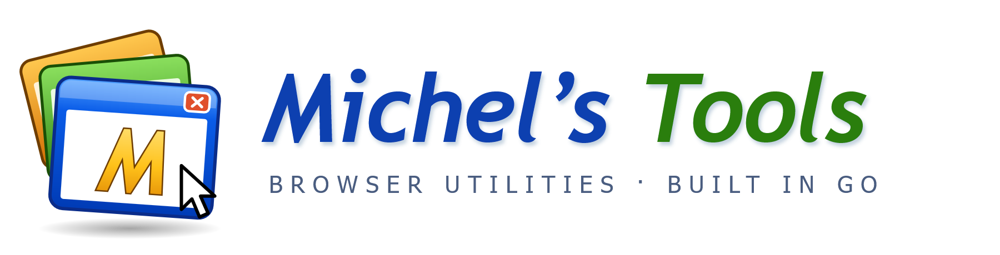
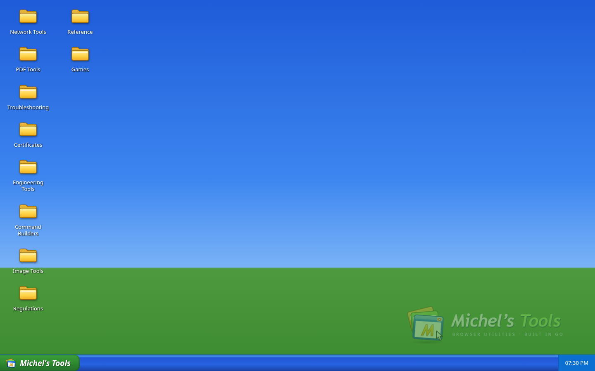
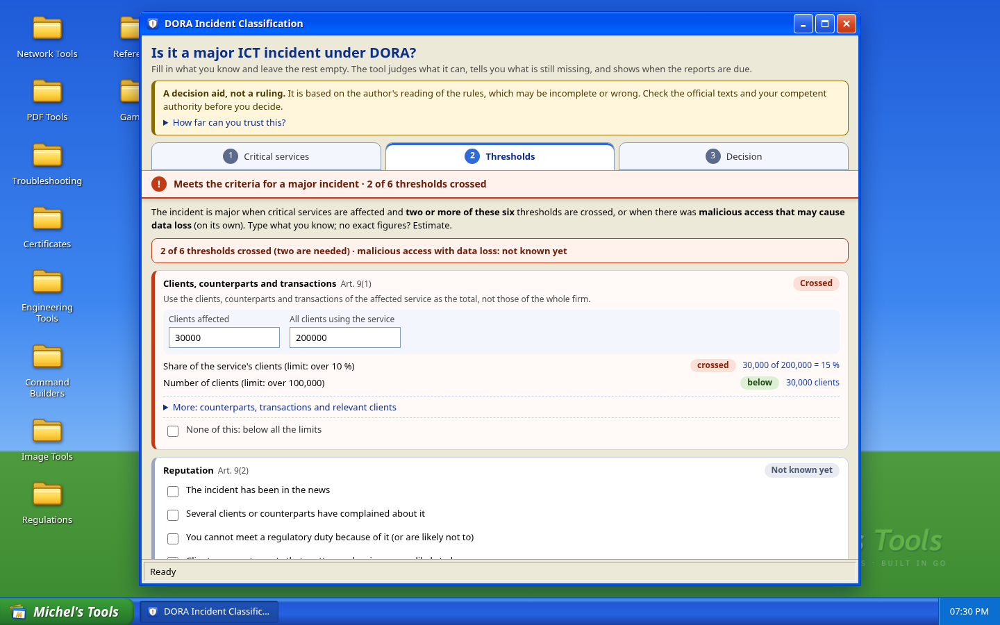
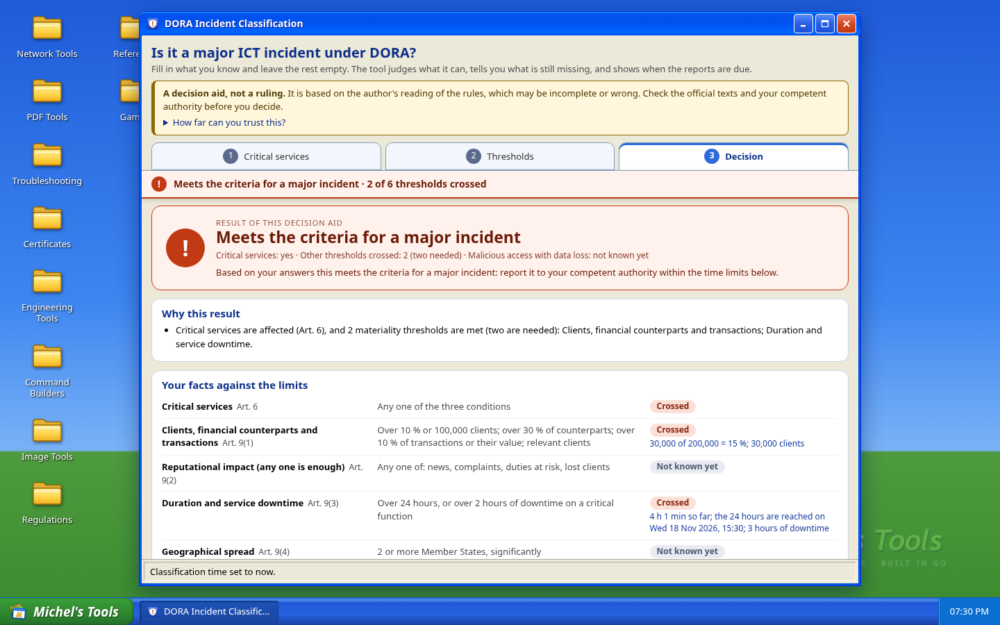
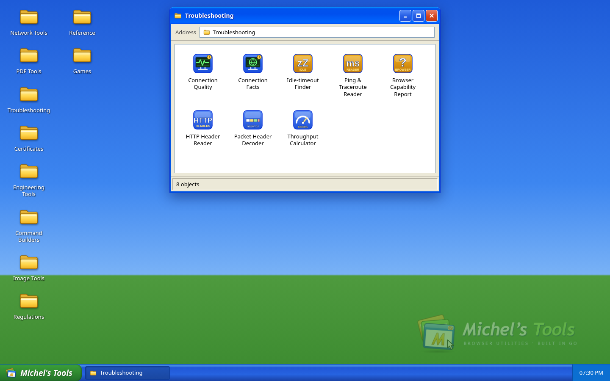
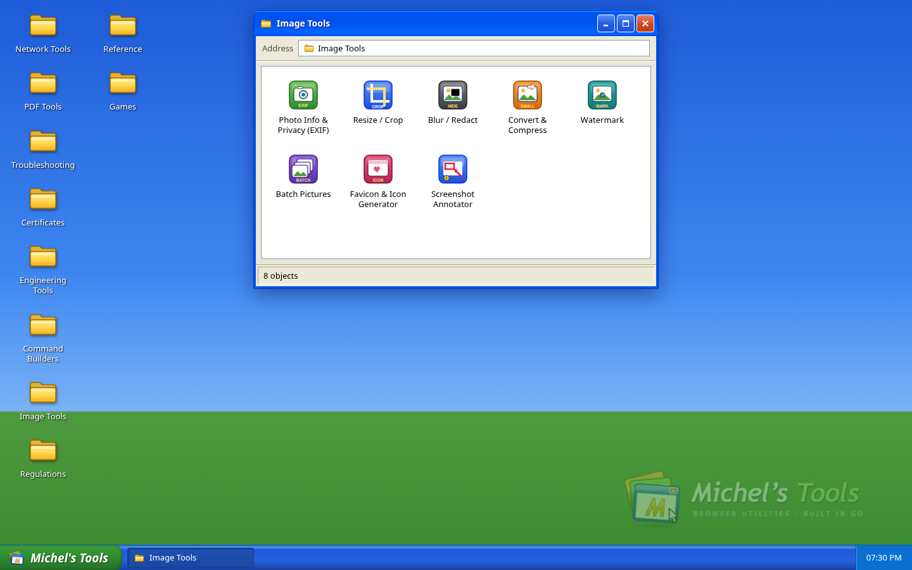
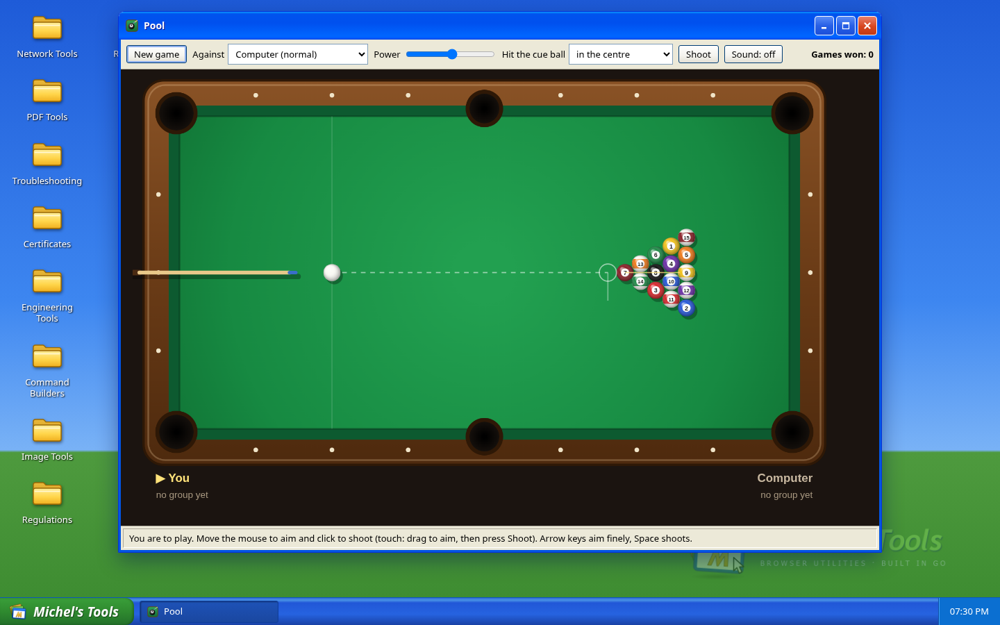
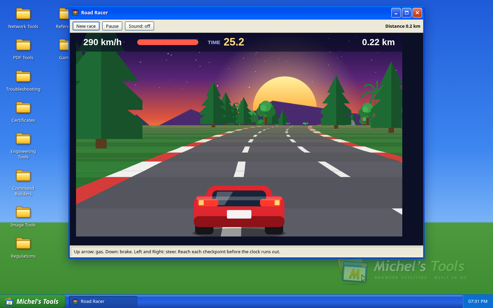

  <picture>
    <source media="(prefers-color-scheme: dark)" srcset="web/brand/logo-dark.png">
    
  </picture>

# Michel's Tools

A small web "desktop" with a classic early-2000s look, served by **one Go program** with all web files embedded. It offers
network tools (IP aggregation, subnet maths, IPv6, MAC lookup and more), PDF tools (redact, merge, sign check and more), connection
troubleshooting tools, image tools (photo privacy and EXIF, blur, resize, compress, watermark, favicons), everyday engineering tools (URL, JWT, cron, chmod, colours and more) and quick reference cards. Almost everything runs **inside the visitor's browser**: PDFs and pasted text never leave it. All icons and
artwork are original; nothing is taken from Microsoft. Not affiliated with or endorsed by Microsoft.

## Screenshots

The desktop, with all ten folders:

**DORA Incident Classification** (Compliance): answer what you know, see how many thresholds are crossed, then get the verdict, the reasons and the reporting deadlines.

Tool folders open as windows:

And there are games, all drawn in the browser with no downloads:

## Quick start

Needs Go 1.24 or newer.

    go build -o michels-tools .
    ./michels-tools

Open `http://127.0.0.1:8080/`. To run it as a service, see [Installation](docs/installation.md).

**The program speaks plain HTTP only: it does no TLS and has no login.** If anyone other than you will use it, run it behind a reverse
proxy or tunnel of your own that provides https, and do not expose its port directly. The
[installation guide](docs/installation.md#use-a-reverse-proxy-or-tunnel-of-your-own-strongly-advised) lists what the proxy must do.
Every tool is on by default: before you offer it to others, [choose your tools and assess the risk](docs/installation.md#before-you-run-it-choose-your-tools-and-assess-the-risk).

## Documentation

- [Installation](docs/installation.md): build, service, reverse proxy advice
- [Configuration](docs/configuration.md): `tools.conf` (switch tools on and off), all flags, limits, sizing
- [Tools](docs/tools.md): what each tool does
- [Server behaviour](docs/server.md): endpoints, the visit log, security measures
- [Development](docs/development.md): adding a tool, tests, project rules

## Security

Please report vulnerabilities privately: see [SECURITY.md](SECURITY.md).

## Licence

Apache License 2.0, Copyright 2026 Michel Bado: see [`LICENSE`](LICENSE) and [`NOTICE`](NOTICE). Third-party material is inventoried in
[`sbom.cdx.json`](sbom.cdx.json) and keeps its own licences.
